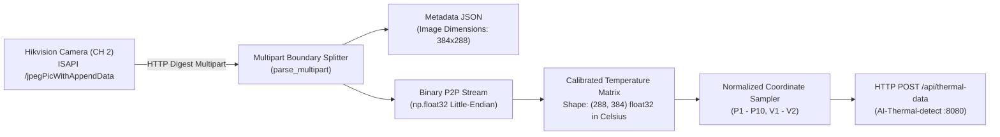
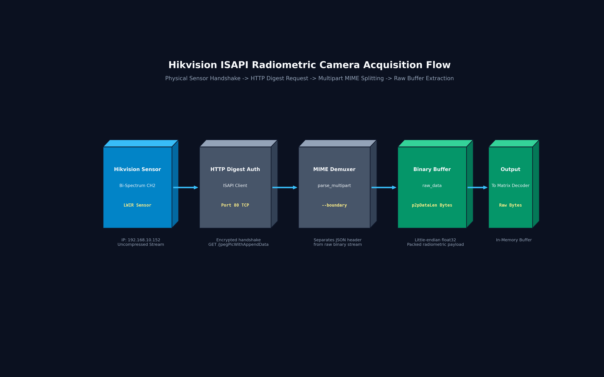
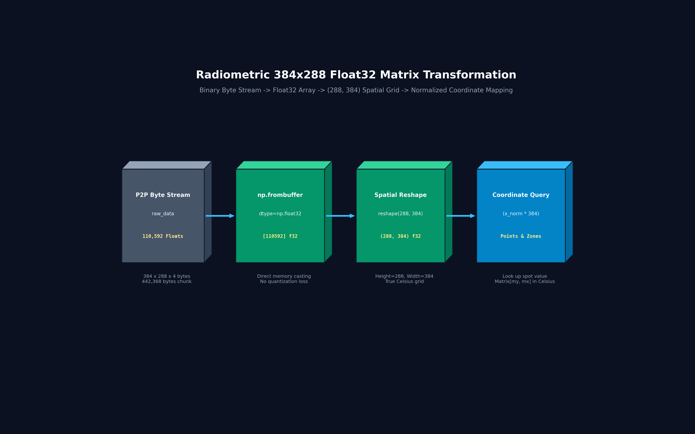
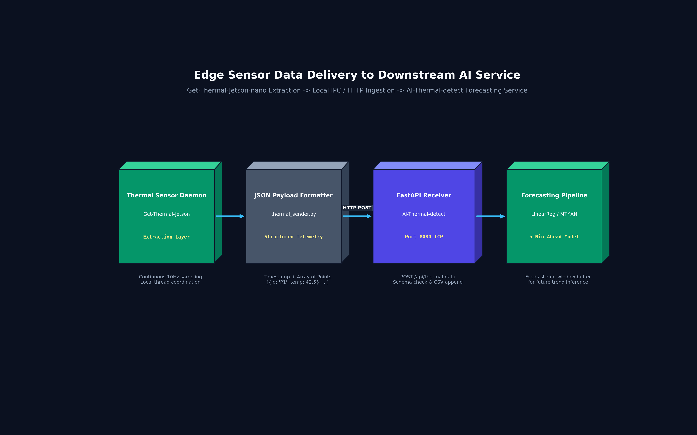

# Embedded Radiometric Sensing & Thermal Acquisition Daemon
### Low-Level ISAPI P2P Radiometric Extraction, Coordinate-Space Mapping, and Thermal Telemetry Relay for NVIDIA Jetson

[](https://developer.nvidia.com/embedded/jetson-modules)
[](https://www.hikvision.com)
[](https://www.python.org/)
[](LICENSE)

---

## 1. Architectural Scope & Role

> **Important Notice on Component Positioning:**  
> This repository serves strictly as an **Embedded Sensing & Data Acquisition Layer**. It does not train, host, or execute deep learning inference models.  
> Its primary objective is interfacing with **Hikvision Bi-Spectrum Thermography Cameras** via industrial ISAPI protocols, extracting raw uncompressed radiometric thermal matrices, and providing a clean coordinate-mapping abstraction for downstream AI services.

Downstream analytics and multi-target time-series forecasting are performed by:
👉 **[`AI-Thermal-detect`](https://github.com/neitpm/AI-Thermal-detect)** *(Main Edge AI & Time-Series Node)*

---

## 2. Ingestion & Transformation Flow

Unlike standard video capture cards that capture 8-bit colorized pseudo-heatmaps (ironbow, rainbow), this daemon acquires the raw physical radiometric matrix from the sensor:



---

## 3. High-Resolution 3D Volumetric Architecture Figures

Below is the suite of isometric 3D volumetric tensor block diagrams detailing the hardware acquisition and radiometric matrix transformation:

#### Figure 1: Hikvision ISAPI Radiometric Camera Acquisition Flow
*Physical sensor handshake, encrypted HTTP Digest authentication, multipart MIME demuxing, and raw binary buffer extraction.*


#### Figure 2: Radiometric 384x288 Float32 Matrix Transformation
*Uncompressed IEEE-754 float32 byte casting, 2D spatial grid reshaping, and normalized coordinate target querying.*


#### Figure 3: Edge Sensor Data Delivery to Downstream AI Service
*Local inter-process HTTP ingestion and payload formatting between the acquisition daemon and the AI-Thermal-detect forecasting engine.*


---

## 4. Coordinate Transformation & Point-Sampling Logic

To allow remote operator configuration without re-deploying edge scripts, target measuring zones are defined in normalized coordinates $[0.0, 1.0]$:

```python
# Conversion from normalized frontend coordinates to matrix index
mx = int(x_norm * matrix_width)
my = int(y_norm * matrix_height)

mx = max(0, min(matrix_width - 1, mx))
my = max(0, min(matrix_height - 1, my))

# Direct float32 radiometric temperature lookup
spot_temp_celsius = float(thermal_matrix[my, mx])
```

---

## 5. Repository Structure

```
Get-Thermal-Jetson-nano/
├── scripts/
│   └── visualize_architecture.py # 3D volumetric diagram generation script
├── docs/figures/                 # 300 DPI isometric volumetric architecture figures
├── thermal_matrix.py             # Standalone daemon with OpenCV GUI for interactive radiometric inspection
├── thermal_receiver.py           # Local HTTP receiver for verification and sample logging
├── dataset_nhiet_do1.csv         # Historical raw temperature measurements acquired from live trials
├── received_data/                # Structured JSON telemetry snapshots captured during site calibration
└── src/                          # Prototype verification scripts
```

---

## 6. Verification & Live Execution

Run the interactive radiometric viewer on a Jetson desktop environment:
```bash
python3 thermal_matrix.py
```

*Interactive Controls:*
- **Left Click:** Place a target probe on any pixel of the live thermal stream to display the exact radiometric Celsius reading.
- **Data Loop:** Configured for periodic sampling over local industrial Ethernet.
